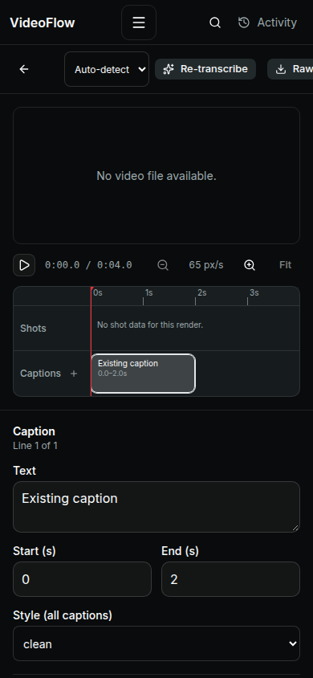
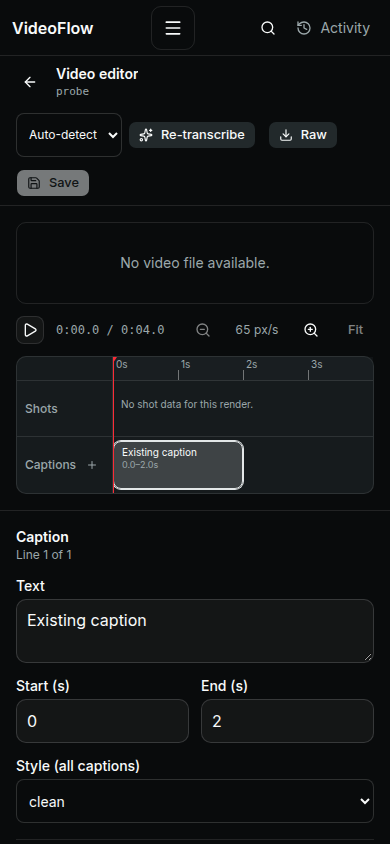

# Whole-application UX audit: implementation closure

Protocol: https://jienweng.github.io/design/llms.txt. Checklist snapshot: `bfae71e507b1b7c03c12e0756402b60eb80f5d14`.

Scope: all 12 VideoFlow route types and shared navigation, Search, Activity, Canvas/chat, reference/media/voice/caption/composition workflows on desktop/mobile web. The user approved implementing verified findings and creating a PR. Preserve the existing font, palette and kind-colored canvas cues.

The original audit selected 42 checklists / 256 items: 127 Present, 28 Partial, 5 Missing, 45 Not applicable, 51 Unverified. All 256 IDs were reported, with no unreported IDs. This closure records code changes and focused verification; it does not relabel unknowns as passes or claim WCAG conformance.

| Finding | Resolution | Verification |
|---|---|---|
| A1 caption keyboard barrier (`design-system-accessibility:04–05`, `web-app-single-item-detail:04`) | Focusable, named cue controls expose selection and handle Enter/Space/arrows without playback/drag propagation. Inspector provides numeric timing edits. | Populated editor browser fixture selects an existing cue by keyboard; mobile toolbar bounds checked. |
| A2 mobile editor overflow (`design-system-typography:06`) | Toolbar and transcription groups wrap; selects respect available width. | 390px fixture locates Save inside viewport. |
| A3/F2 lost drafts (`flows-saving-changes:05`, `web-app-multi-step-form:06`) | Shared client-navigation and unload protection for key, voice/script and composition drafts. Successful saves update baselines; failed/unrelated refreshes retain drafts. Keys stay in memory. | Desktop/mobile Stay/Discard fixtures; no provider request. |
| A4 global New story (`design-system-searchbar:03`) | Off-Studio action navigates with a one-time intent and seeds/focuses Studio chat. | Desktop/mobile navigation and zero chat submission assertion. |
| A5 palette active result (`design-system-accessibility:04–05`, `design-system-searchbar:03`) | Combobox/listbox/options expose active descendant and selected state. | DOM/runtime checks; actual screen-reader testing remains unverified. |
| A6 misleading Characters empty state (`web-app-empty-state:06`, `web-app-list-view:08`, `design-system-alert:01,06`) | Atomic collection fetch, distinct failure/retry and retained previous data. First-use empty copy only after successful empty load. | 503 fixture shows error, hides first-use copy, and recovers populated data on retry. |
| A7 saved composition recovery (`web-app-dashboard:03`) | Project-scoped revision metadata endpoint, Saved edits links, exact revision reopen, and recent dashboard entries. | Go ownership/reopen test and browser saved-index fixture; recent-work unit test. |
| S1 route titles | Distinct Projects/Characters/Assets/Scenes/Creator/Videos document titles. | Source/type/build check and route browser inventory. |
| A9 upload constraints (`flows-uploading-media:04`) | Shared 50 MiB multipart-cap guidance, combined file-size precheck, and supported character-reference formats. | Deterministic cap/overhead/batch/type tests; real upload/decoding still unverified. |
| A10 chat authors (`web-app-chat:03`) | Explicit accessible You/Story assistant labels. | Source/type/build checks; actual spoken output still unverified. |
| F1/F3 validation (`design-system-input-field:04,06`, `design-system-stepper:03–05`, `flows-showing-input-error:03–04`, `flows-submitting-a-form:05`) | Integer 1–120 range, visible hint, field-linked error, invalid value retained and cleared on reattempt. | Browser checks invalid 1.5, linked error, valid correction and save. |
| F4/F8 loading (`design-system-loading:02,04`, `design-system-skeleton:01`) | Named busy/status region and visible loading text; decorative skeletons follow navigation/content structure and respect reduced motion. | Source/type/build and loading/retry browser fixture. |
| F5 credential Save (`design-system-button:05`, `flows-saving-changes:02–03`) | Disabled pristine Save, per-provider dirty status, explicit saving and success feedback. | Browser pristine/edit/leave checks and existing Settings workflow. |
| F6 connection copy (`design-system-accordion:01`) | Disclosure accurately says Add another OpenRouter connection. | Source/rendered inspection. |
| F7/F9 readability and aliases (`design-system-typography:02,07`, `design-system-spacing-and-grid:02`) | Provider/status copy uses 12px+; semantic Settings label/help/section aliases retain the current design. | Type/build and native rendered desktop/mobile inspection. |

## Fresh review follow-up

A fresh reviewer identified activation-before-confirmation when switching projects through Search. A regression reproduced backend activation after cancelling the warning. The fix first navigates through the current screen's guard to Projects, then consumes a one-time navigation state before activating. Browser cases assert cancellation sends zero activation requests and acceptance sends exactly one. This prevents a preserved draft from remaining mounted against a switched backend scope.

## Verification commands and results

- `node --test frontend/src/lib/dashboard/overview.test.mjs frontend/src/lib/director/session-state.test.mjs frontend/src/lib/upload-limits.test.mjs`: 20 passed.
- `npm run check --prefix frontend`: zero errors/warnings.
- `go test ./...` in Go 1.26 with FFmpeg/Python available: passed.
- `scripts/e2e_audit_fixes.mjs`: 14 desktop/mobile checks, zero page errors.
- Existing broad `scripts/e2e_components.mjs`: 36 checks, zero page errors (optional mock `/health` is recorded as unavailable, not a successful health check).
- Existing Settings and composition browser workflows: passed on desktop/mobile.
- Production Docker build and native rendered inspection completed. No paid request, real key mutation or destructive live-data action was used.

Browser scripts use the existing external Playwright runner convention: set `PLAYWRIGHT_MODULE`, `E2E_BASE_URL`, and `CHROME_BIN` (or `CHROME_PATH` for older scripts). All mutation requests in these UI tests are intercepted fixtures. Temporary dev-server/module-reload runs and outdated fixture shapes were excluded from passing verification evidence.

## Remaining verification boundaries

All 51 originally Unverified items remain unknown unless independently exercised above; in particular screen readers, actual browser zoom, physical touch/gestures, the full contrast/focus matrix, provider authentication/quality, real large uploads, and the complete paid-generation/playback/export journey are not certified. Missing team policy/design artifacts are not product defects and were not fabricated.

Unverified IDs:

`design-system-accessibility:01`, `design-system-accessibility:02`, `design-system-accessibility:03`, `design-system-accessibility:06`, `design-system-accessibility:07`, `design-system-accessibility:08`, `design-system-typography:08`, `design-system-color-system:03`, `design-system-color-system:04`, `design-system-color-system:05`, `design-system-color-system:08`, `design-system-spacing-and-grid:07`, `design-system-accordion:04`, `design-system-button:02`, `design-system-input-field:02`, `design-system-loading:03`, `design-system-skeleton:05`, `design-system-toast:05`, `design-system-checkbox:03`, `design-system-checkbox:04`, `flows-submitting-a-form:02`, `web-app-chat:01`, `web-app-list-view:02`, `web-app-notifications:04`, `web-app-notifications:05`, `web-app-multi-step-form:04`, `web-app-multi-step-form:05`, `design-system-card:02`, `design-system-card:04`, `design-system-drawer:02`, `design-system-drawer:05`, `design-system-dropdown-menu:04`, `design-system-dropdown-menu:06`, `design-system-dropdown-menu:08`, `design-system-icon:01`, `design-system-modal:04`, `design-system-table:07`, `design-system-tabs:04`, `design-system-tabs:05`, `design-system-tokens:03`, `design-system-tokens:04`, `design-system-tokens:05`, `design-system-tokens:06`, `design-system-tooltip:02`, `design-system-tooltip:03`, `design-system-tooltip:04`, `design-system-stepper:07`, `flows-filtering-items:04`, `flows-uploading-media:03`, `flows-uploading-media:05`, `flows-uploading-media:06`.

The two style detector warnings (Inter popularity and canvas side accents) remain intentional visual identity choices. No source edits or suppression rules were added for them. Subjective suggestions about navigation density or visual redesign are not silently treated as bugs.

## Mobile editor evidence

Both captures use a mocked captioned output with no media file; they demonstrate toolbar layout, not video playback. Before: Save/download controls extend beyond the visible toolbar. After: the toolbar wraps and Save remains visible.

| Before | After |
|---|---|
|  |  |
