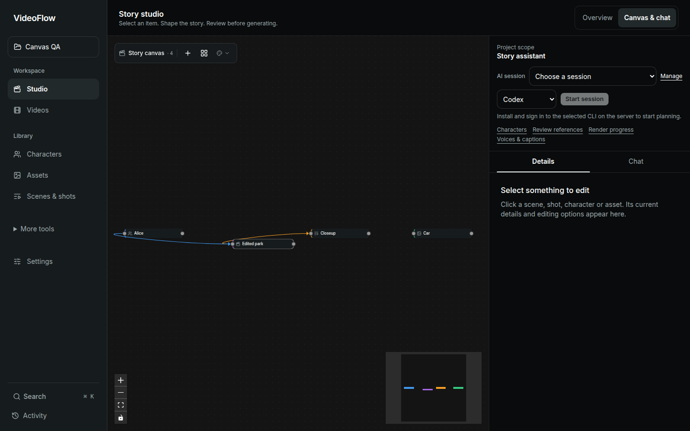
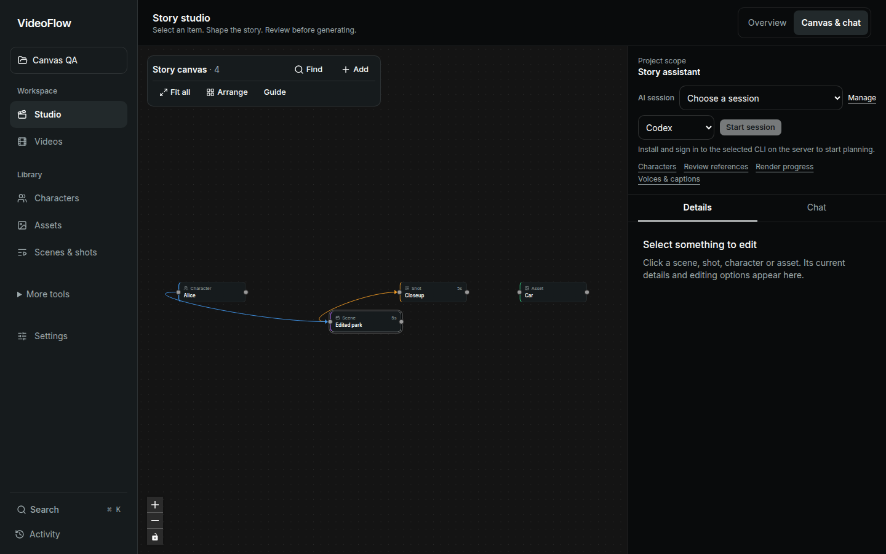
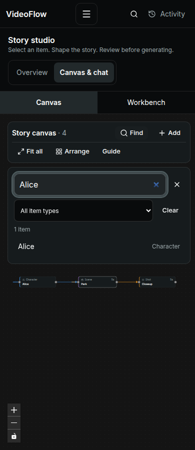

# Canvas usability improvements

The canvas preserves the existing graph, font and kind-color vocabulary while making common tasks visible and reversible.

- On-canvas Find searches item names and kinds, supports type filters and empty-result clearing, and exposes normal keyboard-accessible result buttons.
- Fit all, Arrange and Add have visible labels. Arrange offers Undo that restores exact manually positioned coordinates. The native duplicate Fit control was removed.
- Selecting an item exposes a Connections focus action. Finder/global focus respects the same dirty-edit guard before changing selection or viewport.
- Node cards show their kind, title, applicable duration/status, and a clear selected ring. Layout estimates follow the actual anatomy, and orphan rows reserve enough space for image previews.
- The canvas follows the chosen application theme, respects reduced motion on viewport transitions and avoids continuously animated edges.
- Small graphs no longer carry a large minimap. Larger minimaps are compact and hidden on narrow screens; guidance lives in an explicit Guide disclosure rather than a permanent floating coachmark.
- Delete/Backspace ignores hidden canvases, finder input, controls and editing elsewhere. Local layout storage failures no longer break arrangement/dragging for the visit.

Verification: 22 populated desktop/mobile browser checks, zero page errors; 21 unit tests including a failing-then-passing orphan-image spacing test; Svelte check with zero errors/warnings; production Docker frontend build; native live inspection. The 14 whole-app regression checks also passed. The initial finder ref error was corrected before delivery. A fresh source review found no important regression; its suggested stronger Undo check now drags a node first, confirms Arrange moves it, and verifies Undo restores the exact persisted coordinates. Actual physical-touch and screen-reader testing remain unverified.

All browser edits/requests used intercepted fixtures; no real project content or provider request was changed for verification.

## Rendered evidence

These images use mocked project data, not live generation.

| Before | After |
|---|---|
|  |  |

