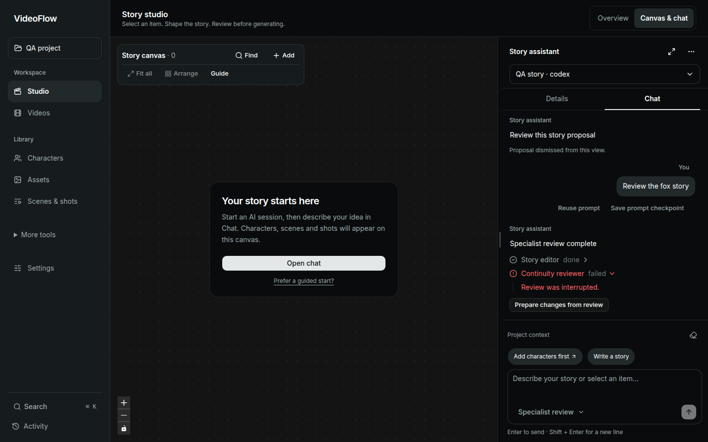
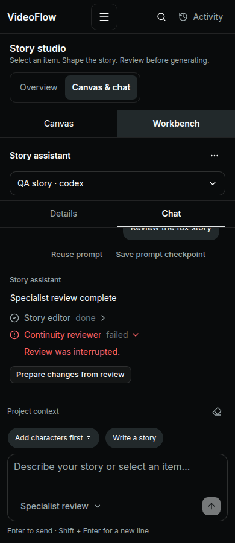

# Current shadcn-svelte AI Elements integration

Source: https://www.shadcn-svelte.com/llms.txt, retrieved 2026-11-12. All 21 linked AI Elements markdown guides were fetched from the official www host. The apex markdown host returned 403, so its working official www equivalent was used. This is an implementation coverage record, not a new full application accessibility audit.

The main user task is to describe a story change, inspect a proposal, and explicitly approve its execution while retaining the canvas. Specialist review adds independent narrative/continuity advice to that task. Existing palette, typography, canvas colors, project selection and paid-generation approval gates remain intact.

## Architecture and scope

The current official patterns are compositions of shared UI primitives, not 21 independent AI engines. The chat now uses the official nova Message Scroller, Message, Bubble, Input Group, Trace, Item, Marker and related primitives. Legacy AI Elements imports were removed from ChatPanel and ActionCard. The custom Go transport remains; scripted AI SDK demo transports and mock replies were not shipped.

Provenance and exported APIs are recorded in [the primitive provenance file](2026-11-12-shadcn-primitive-provenance.md). Registry placeholders were substituted with existing project aliases and Lucide icons as the CLI normally does. Existing unrelated UI primitives and global CSS were preserved. New npm dependencies are pinned by package-lock; the MIT notice accompanies the source and is published at `/licenses/shadcn-svelte.txt`.

## Pattern coverage

Every selected AI Elements pattern is listed in official index order. “Live” means wired to existing application state or an implemented action, subject to local CLI availability. “Adapted” names a deliberate product constraint. “Conditional” means a safe renderer exists and is tested with fixture metadata, but it appears only when real metadata is supplied. No test fixture is compiled into the application.

| ID | Official pattern | Implementation and evidence | Availability |
|---|---|---|---|
| AI-01 | Chain of Thought | Trace public progress summaries and supplied steps. Private model chain-of-thought is not collected or exposed. | Conditional |
| AI-02 | Chat | Official Message Scroller, chronological turns, preserved reading position, explicit jump to latest, setup/loading/error states. | Live |
| AI-03 | Checkpoint | Marker prompt checkpoints restore exact input text, protect an existing draft, and never replay generation. The UI explicitly says native conversation/generated work is unchanged. | Adapted: prompt checkpoints, not native-history rewind |
| AI-04 | Confirmation | Item proposal form retains existing action-specific Run approval and adds explicit dismissal without executing. | Live |
| AI-05 | Context | Renders supplied actual used/limit counts and optional input/output figures. Missing limits produce no fabricated percentage. Local CLI context-window metrics are not currently exposed. | Conditional |
| AI-06 | File Tree | Bounded nested Collapsible folders/files from supplied activity metadata. It does not browse the backend filesystem. | Conditional |
| AI-07 | Inline Citation | Keyboard-accessible HoverCard source chips; only validated HTTP(S) source links, with new-tab labels. | Conditional |
| AI-08 | Message | Official Message/Bubble author, content and footer structure. Existing thumbnails, warnings and proposal content retained. | Live |
| AI-09 | Model Selector | Official DropdownMenu radio pattern selects real saved local engine sessions; composer selects assistant vs specialist review. Per-turn model/effort overrides are not claimed: native CLI defaults govern them. | Adapted: actual session/mode controls |
| AI-10 | Plan | Trace shows the public proposed application workflow and editable proposal parameters; no invented completed steps. Supplied plan events also render. | Live |
| AI-11 | Prompt Input | Official Input Group field and controls, Enter/Shift+Enter, composition-safe submission, real local Stop control, active empty field, selected reference attachment chip. | Live |
| AI-12 | Queue | Pending application background operations appear as a queue; supplied queued-step metadata also renders. | Live |
| AI-13 | Reasoning | A supplied public reasoning summary can be inspected. Native private reasoning is neither fabricated nor requested. | Conditional |
| AI-14 | Sources | Supplied source list, deduplicated validated URLs, descriptive external links. No automatic claim that a local planner browsed. | Conditional |
| AI-15 | Stack Trace | Supplied failure frames/log text in escaped Code Block output. Native account stderr stays discarded. | Conditional |
| AI-16 | Subagent | Real two-worker application-managed Story editor and Continuity reviewer. Isolated fresh read-only CLI processes; saved results, partial failure, cancellation and safe handoff to a main-assistant proposal. | Live when a local CLI is available |
| AI-17 | Suggestion | Official Button suggestion pattern preserves deliberate prompt filling rather than silently triggering generation. | Live |
| AI-18 | Task | Application operation progress and supplied task-step lists use Trace states. | Live |
| AI-19 | Terminal | Escaped, read-only supplied command/output records. There is no interactive shell and native terminal tools remain disabled. | Conditional |
| AI-20 | Test Results | Supplied test suites/steps/failures render as Trace records. This is not an in-product test execution service. | Conditional |
| AI-21 | Tool | Actual application operation states and supplied tool input/output records use Trace/Code Block. Arbitrary native tool execution is not enabled. | Live for application operations; native tools disabled |

Expected 21 IDs; reported 21: 10 Live, 2 Adapted, 9 Conditional. No selected pattern omitted. The conditional items are explicitly not claims that these unavailable native capabilities have been enabled. Model/effort overrides and native conversation rewind remain outside the implemented native protocol.

## Local specialist review

`GET /chat/capabilities` reports actual selected-engine availability and busy/review-required states. `POST /chat/review` makes exactly two independent local planning calls. It uses project/session-scoped request replay, a parent session lock, an eight-minute deadline and the existing cancel route. Parent native identity is unchanged; temporary child workspaces are private and removed afterward.

Both specialists receive selected identities plus the saved project narrative: project details, all saved scenes/shots and saved scripts, explicitly labeled as drafts where no approval flag exists. The endpoint rejects more than 100 scenes, 32 scripts, 1,000 shots or 256 KiB of story data rather than silently dropping narrative. Independent narrative hashing and existing selection revision checks reject stale results. Partial failure is persisted truthfully and requires acknowledgment before another local turn. No automatic retry, recursive native delegation, shell, provider calls or application mutations are authorized by a review.

Successful advice has a “Prepare changes from review” action that fills the main assistant prompt with the actual advice. It protects an existing draft and requires another explicit Send and proposal approval. This keeps the independent reviews useful without implying the parent native thread automatically acquired their private conversation.

## Verification and review

- Full Go suite with FFmpeg/Python, plus focused review/replay/cancellation race tests, passes in the local test-tools image. Tests cover two concurrent isolated workers, parent identity preservation, replay, partial failure/acknowledgment, cancellation, foreign selection, bounds, actual narrative in both prompts and rejection after narrative changes.
- Activity normalization tests cover malformed/oversized events, unsafe source protocols, missing usage metrics and nested partial failures. Escaped code is never evaluated.
- Browser fixtures cover all 14 activity kinds on desktop/mobile, safe citation links, nested files, context counts, multiline input, failed history and sends, prompt checkpoints/draft protection, proposal approval/dismissal, specialist review restoration and cancellation.
- Existing populated-canvas, application and delayed-session isolation regressions are retained. Final counts and screenshots are recorded with the PR.
- Independent review found missing story context in the first specialist implementation. The bounded authoritative story snapshot and post-run hash checks resolved it; the follow-up found no remaining confirmed Critical/Important issues.

No paid/provider generation, actual native account session or real credentials were used in verification. Native CLI detection checks the executable, not sign-in or account access; real access is checked on first use. Physical touch, screen readers, all browser/keyboard combinations, complete contrast inventory and provider/model quality remain unverified.

## Final evidence

88 browser checks passed with zero page errors: 26 populated canvas, 16 chat state/workflow, 30 activity renderer and 14 application regression checks, plus two delayed-session isolation cases. All 26 frontend unit tests pass. Svelte check reports zero errors/warnings, production builds pass, and the published MIT notice is reachable. Final backend full-suite and focused race tests pass.

Conditional capability IDs: AI-01, AI-05, AI-06, AI-07, AI-13, AI-14, AI-15, AI-19, AI-20. Adapted protocol constraints: AI-03 and AI-09. AI-16 was verified with fake local CLI processes; real account access remains unverified.

The following screenshots use intercepted API fixtures to verify partial failures; they are not claims of live model execution.

| Desktop | Mobile |
|---|---|
|  |  |
