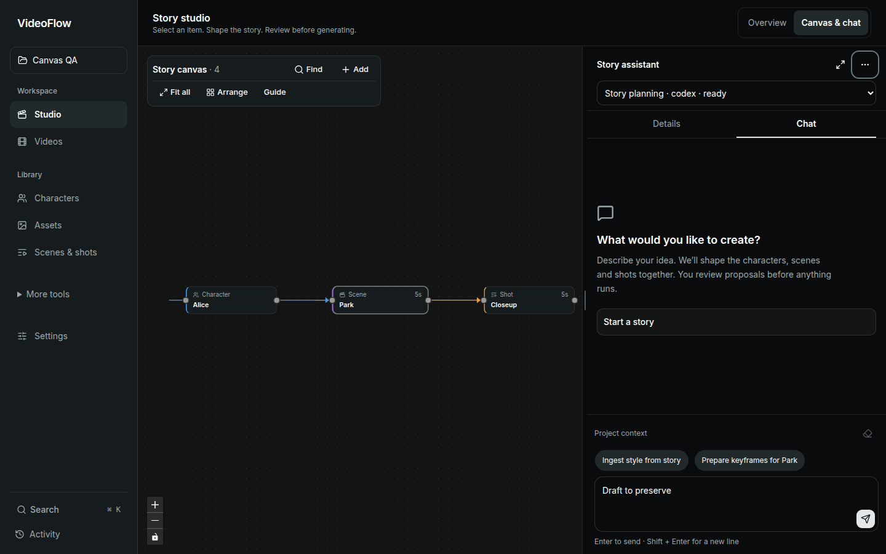
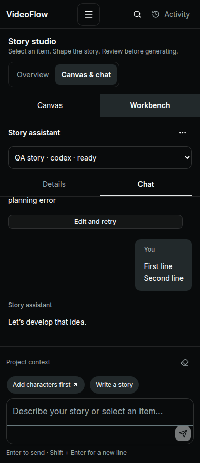

# Integrated story assistant

Audience: creators shaping a story while inspecting its canvas. Main task: select story context, describe a change, review the resulting proposal, then explicitly run it. Scope: Studio workbench and its existing chat UI. This is a focused implementation follow-up to the application audit, not a new claim of complete application conformance.

## Design and implementation

The assistant stays docked to keep the canvas visible. Desktop supports pointer and keyboard resizing plus expand/restore. Mobile retains the full-width workbench, without a modal blocking canvas selection. Chat and Details remain mounted so switching views preserves drafts and the existing dirty-edit guard.

The implementation uses the existing Svelte AI Elements Conversation, Message, Prompt Input, Task and Reasoning components. No React adapter, second chat framework, new provider transport or backend migration was introduced. The existing Bits UI dropdown contains secondary workflow links. Ordinary replies no longer repeat a generic capabilities card or irrelevant proposal explanation; real proposal cards and backend next-step guidance remain available. A compact session selector stays visible; selected context appears once beside the composer with a clear action. The empty state offers a prompt-filling action, and message authors are now visible.

Missing sessions, history loading, history failures and empty conversations have separate states. History failures offer retry without replacing saved history. Send failures offer Edit and retry, restoring the original multiline prompt for explicit resubmission. The send control stays disabled while working rather than advertising cancellation that the backend does not support. Proposals still require their existing explicit action.

## Checklist evidence

The guide index was already available locally from the prior full audit, pinned to `bfae71e507b1b7c03c12e0756402b60eb80f5d14`. The online index fetch failed during this follow-up, so the guide's offline provision was used. Relevant cached checklists were read with their descriptions and tips: [Chat](https://www.checklist.design/web-app/chat) and [Empty state](https://www.checklist.design/web-app/empty-state). Other shared component/foundation coverage remains in the preceding application audit; it was not fully re-audited here.

IDs below are local to this follow-up and preserve source item order. Present means implementation evidence exists within the stated scope; it does not imply assistive-technology certification.

| ID | Checklist / item | Result and evidence |
|---|---|---|
| CHAT-01 | Chat / Message thread | Present. AI Elements chronological log; browser fixture restores 25 turns, scrolls into history, sends a new message, verifies position stays, then jumps to latest. |
| CHAT-02 | Chat / Message input | Present. Named multiline composer. Browser verifies Shift+Enter does not send, Enter sends, failed message can be edited and explicitly resubmitted. |
| CHAT-03 | Chat / Sender identification | Present for an assistant conversation. Visible You / Story assistant labels on messages; existing user bubbles distinguish roles. Avatars would be redundant for these two fixed identities. |
| CHAT-04 | Chat / Timestamps | Missing, pre-existing. This change does not invent times for restored records or add a timestamp contract. Lower-priority follow-up: expose actual turn times consistently and render accessible date/time labels; verify restored and newly sent turns. |
| CHAT-05 | Chat / Read receipts | Not applicable. There is no second human participant or human read-state contract. Working state conveys request progress. |
| CHAT-06 | Chat / File and media sharing | Partial, pre-existing. Generated thumbnails and references remain supported; arbitrary uploads into chat remain outside this change. Existing Assets flow handles references. Live generated media was not requested in tests. |
| CHAT-07 | Chat / Reactions | Not applicable. No collaborative reaction flow; proposal actions are the supported response mechanism. |
| EMPTY-01 | Empty state / Illustration or icon | Present. Existing Lucide message icon signals a conversation, without decorative artwork. Rendered desktop/mobile evidence below. |
| EMPTY-02 | Empty state / Clear heading | Present. What would you like to create? / Let’s work on [selection], with a separate Connect your story assistant heading when no session exists. |
| EMPTY-03 | Empty state / Supporting description | Present. Short task guidance names story elements and explicitly states proposal review. |
| EMPTY-04 | Empty state / Primary action | Present. Start a story / Develop this idea fills and focuses the composer without generating; setup state links directly to AI sessions. Browser verifies starter action and no automatic send. |
| EMPTY-05 | Empty state / Zero state vs. no-results state | Not applicable to this conversation. No chat search/filter was added; canvas search keeps its independent no-results state and reset. |
| EMPTY-06 | Empty state / Error state variant | Present. Loading and history errors precede empty-state rendering; browser verifies error never appears as empty, retry recovers, and disconnected submission is disabled. |

Expected 13 items; reported 13: 8 Present, 1 Partial, 1 Missing, 3 Not applicable. Remaining IDs: CHAT-04 (timestamps), CHAT-06 (arbitrary chat uploads). These are pre-existing capabilities outside the approved layout and integration change, not reported as fixed.

## Verified usability findings resolved

| Checklist/item | Location and evidence | Severity | Fix and verification |
|---|---|---|---|
| Chat / Message thread | Studio sidebar repeated selection/context in several regions and used a fixed width. Screenshot supplied by user. | Medium | Consolidate context beside composer and resize/expand without remounting. Browser checks keyboard and pointer resize, expand/restore, draft persistence and clear selection. |
| Chat / Sender identification | ChatPanel previously exposed author names only to assistive technology. Source and populated fixture. | Medium | Visible role labels; populated desktop/mobile screenshots and retained accessible log. |
| Empty state / Clear heading, Primary action | Fake greeting occupied the first message position with no task-starting action. Source and supplied screenshot. | Medium | Dedicated empty state with prompt-filling action; first actual send removes the synthetic greeting from conversation history. |
| Empty state / Error state variant | Failed history load appeared as an ordinary assistant message; missing session guidance shared the thread styling. | Medium | Separate setup/loading/error states, disabled submission and retry. Browser checks each state and recovery. |
| Chat / Message thread | Existing AI Elements scroll context used a 200px bottom threshold. A browser regression reproduced a forced jump while reading 80px above the bottom. | Medium | Follow only within a 4px rounding tolerance of the bottom; preserve position above it. Track movement into history separately from content growth, retain following through composer/content resizing, and move directly when following so animation positions are not misread as manual scrolling. Browser checks reading at the start and near the end, plus explicit jump-to-latest. |
| Chat / Message input | Failed sends gave text errors without a way to restore the cleared multiline prompt. | Medium | Edit and retry restores the original text and requires another send. Browser verifies both lines and subsequent success. |

## Verification and limitations

- Production build passed; Svelte check found zero errors and warnings.
- Populated canvas/browser suite: 26 checks across desktop 1440px and mobile 390px, including existing scene edits, dirty guards, selection payload, layout undo, and new assistant controls; zero page errors.
- Chat state suite: 10 checks across desktop/mobile, covering setup, failed history/retry, multiline failed sends/retry, automatic following to the completed reply, preserved reading position (including 80px above the bottom), jump-to-latest, and retained proposals that never run automatically. Mobile uses reduced-motion emulation; zero page errors.
- Existing application regression suite: 14 checks; unit suite: 21 tests.
- Live application inspected with the collaborative browser. All browser test writes were intercepted fixtures, with no paid generation or real credential changes.

A Svelte compiler warning for the focusable WAI-ARIA window splitter is narrowly ignored at that element: the separator has orientation, current/min/max values, controlled panel ID, keyboard adjustment and pointer handling. No Impeccable rules, fonts or colors were suppressed or changed.

Physical touch, screen readers, real provider response quality, real media attachment/generation, complete contrast inventory and every mobile keyboard/browser combination remain unverified. The docked-panel preference is a design choice; comparative user testing has not established it as universally better.

## Screenshots

| Desktop | Mobile |
|---|---|
|  |  |
