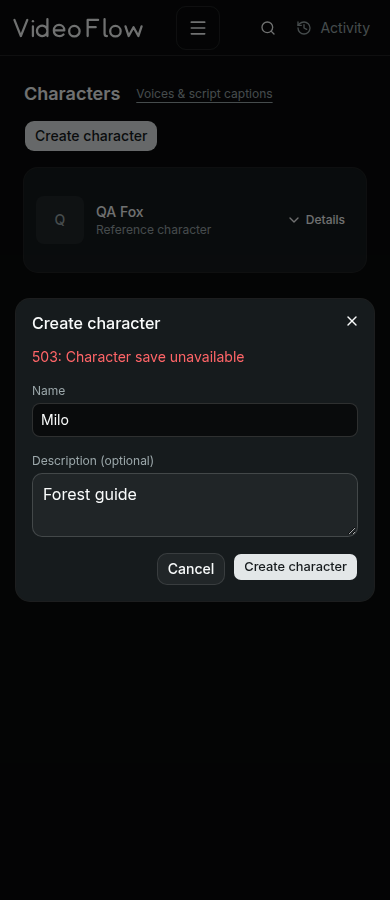
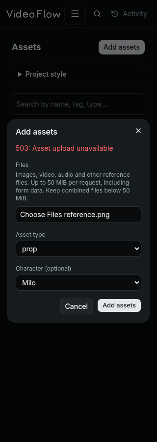
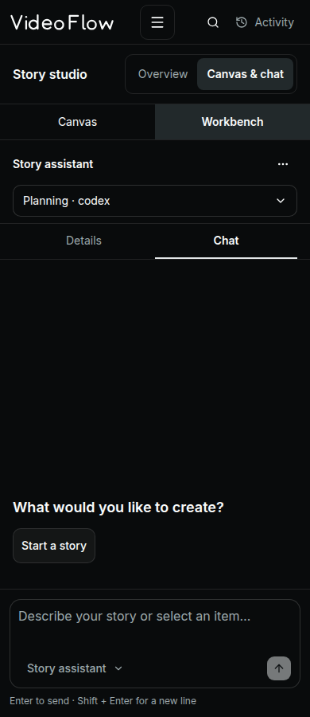

# Creation dialogs, chat empty state and VideoFlow branding

Character creation and asset upload now open from primary header buttons. The lists no longer carry permanent creation forms. Character name/optional description and asset files/type/optional character link remain the same backend operations. Project style is a collapsed section on the Assets page.

Both creation dialogs preserve failed submissions, disable fields while submitting, return focus on close, and guard unfinished drafts. Escape, outside click, Cancel and the close control share the same guarded close behavior. A browser regression exposed a controlled-dialog Escape issue; preventing the primitive's default dismissal and handling closure explicitly resolved it. Creation errors stay inline rather than duplicating a toast. These dialogs use a dimmed, unblurred backdrop through a narrowly scoped optional overlay class; other dialog defaults are unchanged.

The chat empty state now places one compact starting action near the composer, without the generic icon, repeated description, project-context label or second story-starting chip. Selection-specific suggestions are retained.

VideoFlow has a custom drawn SVG wordmark, using original monoline letter paths rather than an icon-library symbol. A related VF mark is used in the collapsed sidebar and browser favicon. The full wordmark appears in the expanded sidebar and mobile header; it follows the existing text color for light/dark themes. Reusable assets:

- [Wordmark SVG](../../frontend/static/brand/videoflow-wordmark.svg)
- [Compact mark SVG](../../frontend/static/brand/videoflow-mark.svg)
- [Inline brand component](../../frontend/src/lib/shell/BrandLogo.svelte)

Verification covers creation-only visibility, empty validation, dirty dismissal, failed submission recovery, successful list updates, file/type/character preservation, chat duplication removal, SVG/favicon application and overflow at desktop 1440px and mobile 390px/320px. The prior chat/canvas and sidebar regression suites also pass. Svelte check reports zero errors/warnings; production build and both SVG XML validations pass. All test writes are intercepted fixtures; no real user records, uploads or paid generation were submitted. Physical touch and assistive-technology testing remain unverified.

Final browser results: 15 creation/branding checks across three widths, 16 chat-state checks, 26 canvas checks and 7 sidebar checks pass with zero page errors (64 total). Existing component empty-validation coverage was updated to open the new dialog. Screenshot failures below are intercepted fixtures demonstrating recovery, not real failed user uploads.

| Character creation | Asset creation at 320px | Simplified chat and wordmark |
|---|---|---|
|  |  |  |
